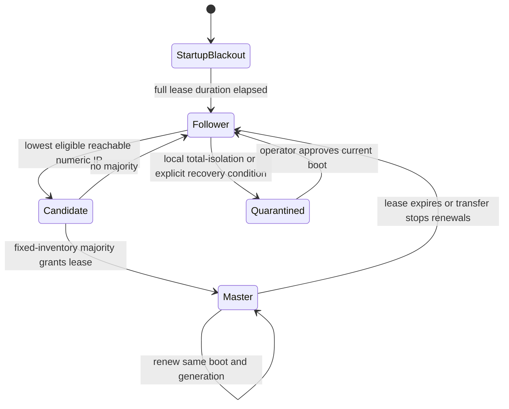
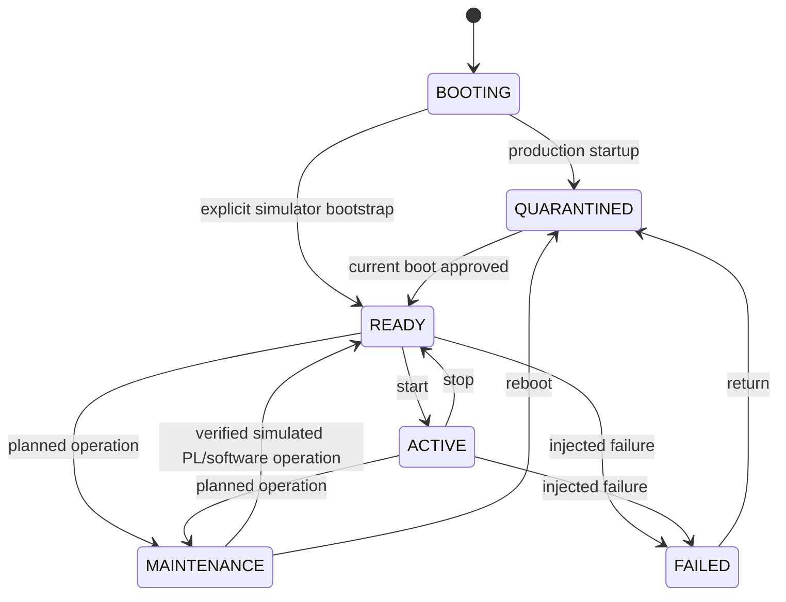
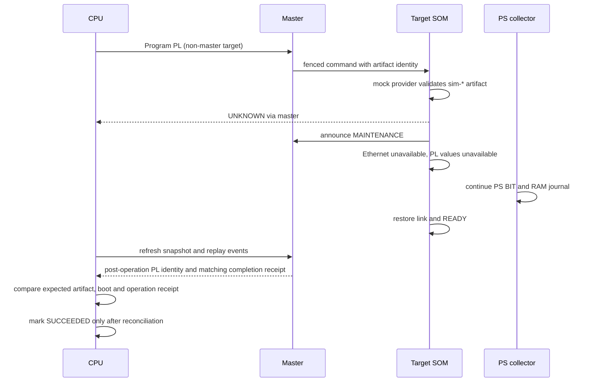
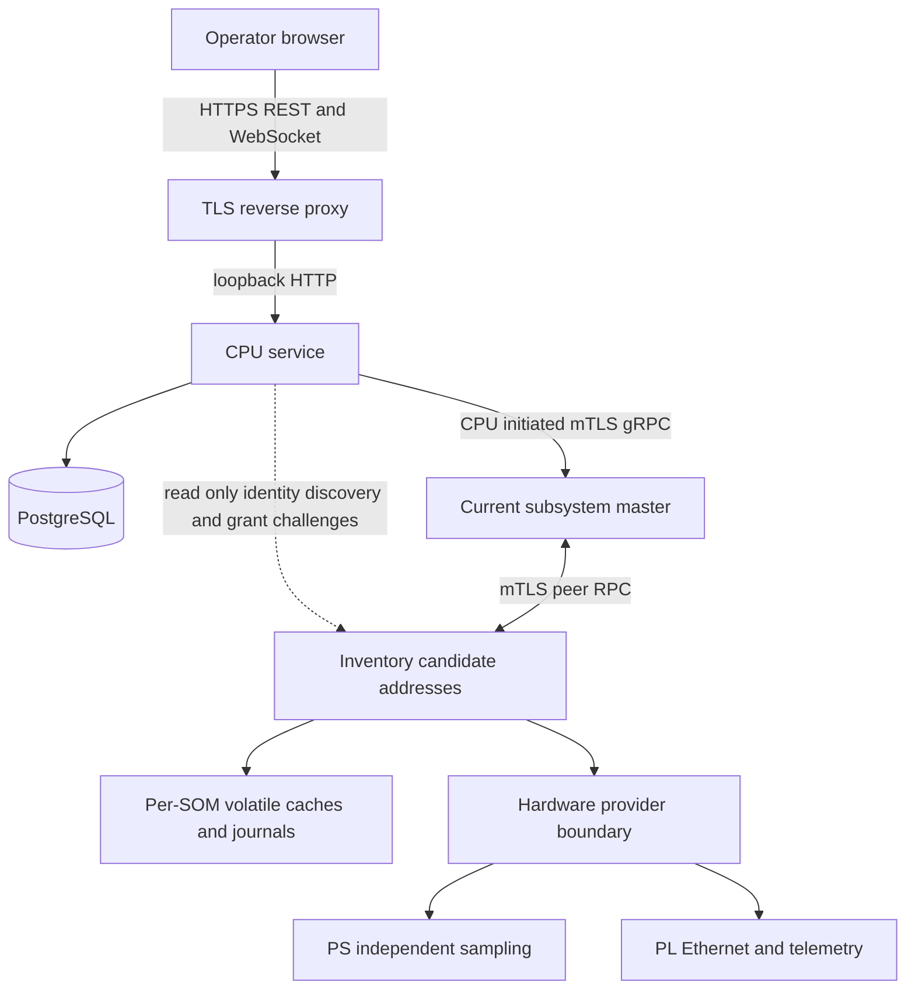

# Implemented state and sequence diagrams

## Master failover


## SOM operational lifecycle
Connection CONNECTED/DISCONNECTED and role MASTER/FOLLOWER are orthogonal to this lifecycle.


## Archive and replay
```mermaid
sequenceDiagram
    participant S as Source SOM journal
    participant M as Master
    participant C as CPU
    participant D as Archive database
    C->>M: Events stream (separate from Live)
    loop bounded pages of 128
        M->>S: Replay
        S-->>M: boot / sequences / retained events / gaps
        M-->>C: event page
        C->>D: INSERT ON CONFLICT DO NOTHING + gap records
        D-->>C: COMMIT succeeded
        C->>M: Acknowledge source boot and sequence
        M->>S: relay Acknowledge
        S->>S: release acknowledged journal entries
    end
    Note over S,D: disconnect retries retained events; reboot destroys unarchived RAM
```

## Command processing
```mermaid
sequenceDiagram
    actor O as Operator
    participant G as GUI
    participant C as CPU
    participant V as Fixed voting peers
    participant M as Master
    participant S as Target SOM
    O->>G: request and confirm disruptive operation
    G->>C: authenticated request / command UUID / boot ID
    C->>C: authorize and validate
    C->>V: challenge current master grants
    V-->>C: quorum confirms live generation
    C->>C: persist accepted request and audit
    C->>M: Command + authority
    M->>V: validate live grants
    M->>S: route command
    S->>V: independently validate grants
    S->>S: validate boot, quarantine and deadline; execute adapter
    S-->>C: result via master (UNKNOWN for reset/PL/update/transfer)
    C->>C: reconcile later snapshot; persist outcome
    C-->>G: WebSocket update
```

## PL programming


## Network and deployment

